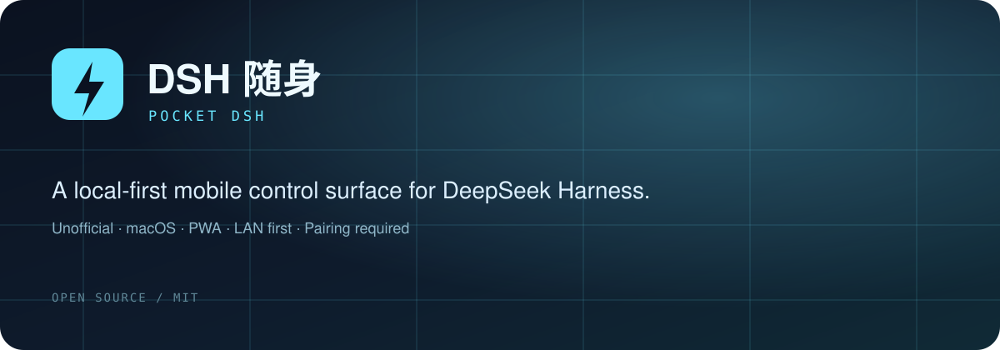
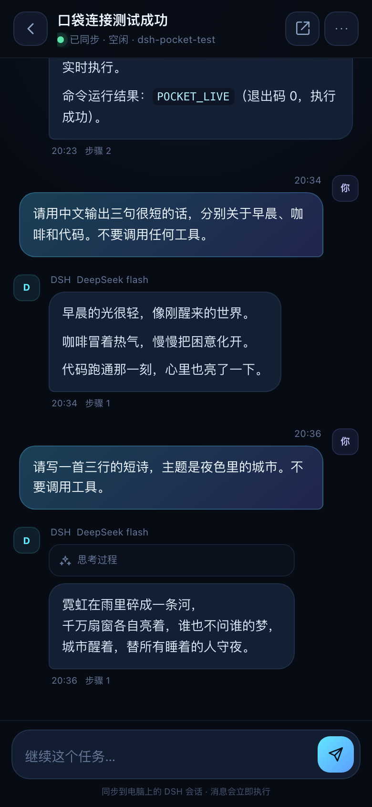
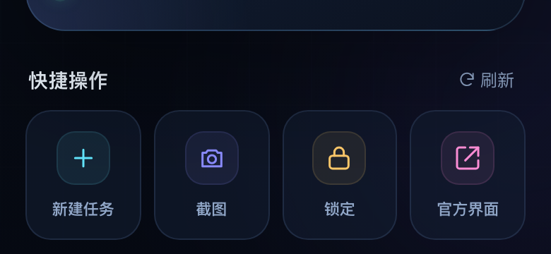

# DSH 随身 · Pocket DSH



[github.com/simonwar119-wq/dsh-pocket](https://github.com/simonwar119-wq/dsh-pocket)

> **非官方实验项目。** 这个项目可以远程控制一台 Mac：截屏、鼠标、键盘、运行任务。请只在你自己拥有、且可信的设备和网络上使用。公开到公网前必须使用 HTTPS 和强配对，并阅读 [SECURITY.md](SECURITY.md)。

把 **DeepSeek Harness** 装进口袋：手机与电脑同一个 Wi-Fi，配对后就能同步会话、发任务、看实时输出，并在手机上远程控制 Mac 桌面。

> 这是一个本地优先的实验性客户端，不是 DeepSeek 官方产品。它直接连接你电脑上的 DSH，不经过任何第三方服务器。

> 公开仓库只包含脱敏演示截图；真实主机名、局域网地址、配对码、设备令牌和会话内容不会上传。

## 能做什么

- **会话同步**：读取电脑上 DSH 的会话列表、标题、项目目录、运行状态。
- **实时对话**：在手机继续电脑上的会话，实时看到 DSH 的思考摘要、工具调用和流式输出。
- **远程发任务**：选择工作目录新建任务，任务在电脑上执行。
- **会话控制**：停止当前 turn、重命名会话、打开完整官方 DSH 界面（用于审批、设置模型等）。
- **桌面预览**：手机查看 Mac 桌面截图，支持刷新。
- **远程触控**：轻点点击、拖动滚动、远程键盘输入、切换应用。
- **系统快捷操作**：截屏、静音、锁定、休眠、调度中心、显示桌面。
- **局域网配对**：二维码 / 6 位配对码，配对令牌只保存在两端；DSH 的登录 Cookie 不会下发到手机。
- **PWA**：可以“添加到主屏幕”，像 App 一样全屏打开。


## 界面与功能截图

<p align="center">
  
</p>

<p align="center">
  
</p>

- **对话页**：手机继续电脑上的会话，实时看到输出、工具调用与阶段摘要。
- **快捷操作**：新建任务、截图、锁定 Mac、打开完整官方界面。
- **首页/配对**：局域网二维码或 6 位码配对，添加主屏幕后像 App 一样打开。
- **远程桌面**：需要时查看 Mac 屏幕、点击、滚动和键盘输入（需系统权限）。

> 截图为演示数据；真实界面以你自己的安装版本为准。

## 快速开始

### 1. 启动

双击 **`启动 DSH 随身.command`**。

终端会打印：

```text
手机访问   http://192.168.x.x:8797
配对码     123 456
电脑设置   http://127.0.0.1:8797/setup
```

浏览器会自动打开电脑设置页。如果没有自动打开，手动访问 <http://127.0.0.1:8797/setup>。

> 需要电脑上的 **DeepSeek Harness** 已经打开。手机和电脑必须在同一个 Wi-Fi / 局域网内。

### 2. 扫码配对

手机用相机扫描电脑设置页上的二维码；也可以手动打开终端里的“手机访问”地址，输入 6 位配对码。

配对成功后，手机会自动进入首页。

### 3. 添加到主屏幕

- **iPhone / iPad**：Safari 打开 → 分享 → 添加到主屏幕。
- **Android**：Chrome 菜单 → 添加到主屏幕 / 安装应用。

> 由于默认走局域网 HTTP，手机浏览器不会注册 Service Worker；加桌后会以全屏 Web App 方式在线使用，不提供离线缓存。若需要完整 PWA 安装能力，可在路由器或 Tailscale 上配置 HTTPS 反向代理并访问 HTTPS 地址。

### 4. 首次远程控制授权

在 Mac 上给运行 DSH 的应用（或终端）授予：

- **系统设置 → 隐私与安全性 → 屏幕录制**：用于桌面截图。
- **系统设置 → 隐私与安全性 → 辅助功能**：用于鼠标点击、滚动和键盘输入。

授权后如果仍不生效，退出并重新启动 DSH 随身。

## 在外面使用（Tailscale）

桥接服务只在你自己的局域网里可达。如果要在公司、4G/5G 或旅行途中使用，推荐 **Tailscale**：它把 Mac 和手机放进同一个私有虚拟网络，不需要公网 IP，也不需要路由器端口转发。

### 一次性设置

1. 在 Mac 上安装 [Tailscale](https://tailscale.com/download)，登录一个账号（Google / Apple / Microsoft / GitHub 均可）。
2. 在 iPhone / Android 的 App Store / Play Store 安装 Tailscale，登录**同一个账号**。
3. 在 Mac 的「系统设置 → 通用 → 登录项与扩展 → 网络扩展」里允许 **Tailscale Network Extension**（需要 Touch ID 或密码）。
4. 打开 Tailscale，点 **Connect**。手机端也打开 Tailscale 并保持连接。
5. 刷新电脑设置页 <http://127.0.0.1:8797/setup>，会出现 **「外网访问 · Tailscale」** 卡片和二维码。
6. 手机用相机扫描这个二维码配对；配对后把 **Tailscale 地址**添加到主屏幕。以后即使不在家，只要 Mac 开着、联网、Tailscale 在线，就可以使用。

> **重要**：主屏幕图标要用 **Tailscale 外网地址**，不要用 `192.168.x.x` 的局域网地址。局域网地址只在家里有效。
>
> 外网地址形如 `http://100.x.x.x:8797`。这个 IP 是 Tailscale 分配的稳定地址，不需要公网 IP。手机端必须保持 Tailscale 连接；关闭 Tailscale 或退出登录后外网地址会失效。

### 安全说明

- Tailscale 流量是加密的，但本应用内部仍然是 HTTP；它的安全边界是“只有你的 tailnet 设备可以访问”。
- 不要把自己的 Tailscale 账号或设备分享给不可信的人。
- 完整 DSH 界面同样可以通过 Tailscale 打开：`http://100.x.x.x:8798/`。

## 开机自动启动与插电不休眠

双击 **`安装为开机启动.command`**。它会安装三个 LaunchAgent：

```text
~/Library/LaunchAgents/com.dshpocket.server.plist       # 桥接服务，KeepAlive
~/Library/LaunchAgents/com.dshpocket.dsh.plist          # 登录后打开 DeepSeek Harness
~/Library/LaunchAgents/com.dshpocket.caffeinate.plist   # 插电时阻止系统睡眠
```

以后登录 Mac 就会自动启动。不要时双击 **`卸载开机启动.command`**。

日志：

```text
~/Library/Logs/DSH-Pocket.log
~/Library/Logs/DSH-Pocket.error.log
```

安装脚本只会添加 `caffeinate -s`；是否修改系统的 AC 睡眠设置由你自行决定。

> **合盖仍可能睡眠**：macOS 默认在合盖时进入睡眠，`caffeinate` 不一定能覆盖。要合盖使用，需要外接显示器 + 电源的 Clamshell 模式，或用管理员权限执行 `sudo pmset disablesleep 1`。后者会让 Mac 永不睡眠（电池供电时也生效），不建议无脑开启。

## 工作方式

```text
┌─────────────┐      HTTP + SSE      ┌──────────────────────┐
│  手机 PWA   │  ←───────────────→   │  DSH 随身 Bridge      │
│  web/       │   配对 Cookie        │  server/index.mjs     │
└─────────────┘                      │  ├─ 静态 PWA          │
                                     │  ├─ /api/* 简化接口   │
                                     │  ├─ /api/screen.jpg   │
                                     │  └─ 远程输入/系统操作 │
                                     └──────────┬───────────┘
                                                │ 本机注入 DSH Cookie
                                                │ HTTP / WebSocket
                                     ┌──────────▼───────────┐
                                     │ DeepSeek Harness Web  │
                                     │ 127.0.0.1:65440       │
                                     └──────────────────────┘

手机 ──→ http://<Mac LAN IP>:8798/ ──→ 官方 DSH 界面反向代理
```

- Bridge 从 `~/.dsh/.credentials.yaml` 读取 DSH 浏览器会话密钥，在**本机内存中**签发 DSH Cookie。
- 手机只拿到 Bridge 自己的设备 Cookie；Bridge 用 DSH Cookie 访问 `127.0.0.1`。
- 会话数据来自 DSH 的 `session/list` 和 `session/follow` WebSocket，实时流再用 SSE 推给手机。
- 官方界面通过 `8798` 端口反向代理，手机浏览器会得到一个相同的 DSH 页面，但地址和 Cookie 都由 Bridge 处理。
- 所有数据都在本机 / 局域网内，不需要云端中转。

## 安全边界

- 配对码 **10 分钟有效**，默认只能用一次；每次配对生成新的设备令牌。
- 配对完成后，手机需要通过 HttpOnly、SameSite=Strict 的 Cookie 访问 API。
- 所有修改类请求都要求 `X-DSHPocket: 1` 并校验 `Origin`，降低 CSRF 风险。
- 服务端校验 `Host`，只接受本机局域网地址 / 本机名，降低 DNS rebinding 风险。
- 配对设备上限 12 台，支持在手机“我的”页移除。
- **不要在公共 Wi-Fi 上配对**。局域网 HTTP 不具备传输加密，同一网络内的攻击者可能嗅探配对或会话 Cookie。需要更强安全时，请把服务放到 Tailscale/HTTPS 反向代理之后。
- 远程控制权限等同于操作这台 Mac 的鼠标键盘。请只在可信设备上配对。

## 目录

```text
dsh-pocket/
├── server/
│   ├── index.mjs        HTTP API、静态服务、SSE、配对
│   ├── dsh.mjs          DSH 发现、Cookie 注入、unary/WS 客户端
│   ├── sessions.mjs     会话同步、事件归一化、实时流
│   ├── system.mjs       系统状态、截屏、鼠标键盘
│   ├── proxy.mjs        官方 DSH 界面 HTTP/WS 反向代理
│   ├── auth.mjs         配对码、设备 Cookie、Host 校验
│   └── vendor/ws/       随包携带的 WebSocket 客户端
├── web/
│   ├── app.js           手机 PWA 前端
│   ├── app.css          移动端设计系统
│   ├── setup.html/js    电脑端配对页
│   ├── manifest.webmanifest
│   └── icons/
├── native/input.swift   macOS 鼠标/键盘辅助工具（首次使用时编译）
├── bin/                 编译后的辅助工具
├── 启动 DSH 随身.command
├── 安装为开机启动.command
└── 卸载开机启动.command
```

## 开发

无需 `npm install`（前端零构建，服务端只使用 Node 内置模块 + 随包 `ws`）。

```bash
cd dsh-pocket
# 使用 DeepSeek Harness 自带的 Node
NODE="/Applications/DeepSeek Harness.app/Contents/Resources/runtime/primary-runtime/dependencies/node/bin/node"
"$NODE" server/index.mjs --no-open
```

可用环境变量：

| 变量 | 默认值 | 说明 |
| --- | --- | --- |
| `DSH_POCKET_PORT` | `8797` | 手机端与 API 端口 |
| `DSH_POCKET_PROXY_PORT` | `8798` | 官方 DSH 界面代理端口 |
| `DSH_POCKET_HOST` | `0.0.0.0` | 监听地址 |
| `DSH_POCKET_UPSTREAM` | 自动发现 | 手动指定 DSH Web 地址，如 `http://127.0.0.1:65440` |
| `DSH_POCKET_TRUSTED_HOSTS` | — | 额外允许的 Host（逗号分隔，用于自定义域名） |
| `DSH_POCKET_OPEN` | `1` | 启动时是否打开设置页；`0` 关闭 |

自检：

```bash
"$NODE" --check server/index.mjs
"$NODE" --check web/app.js
"$NODE" server/index.mjs --no-open   # 另开终端
curl http://127.0.0.1:8797/health
```

## 已知限制

- **审批 / 选项 / 模型设置** 目前在完整 DSH 界面处理：会话右上角 ↗ → 打开官方界面（需要手机浏览器已配对）。后续可以接入 DSH 的 waterfall 事件来实现原生审批卡片。
- **只在 macOS 上验证**。系统操作、截屏、输入辅助都使用 macOS 原生接口；其他平台需要替换 `system.mjs` 与 `native/input.swift`。
- **PWA 不是 App Store / TestFlight 原生包**。这是一个可安装的 Web App，便于立即使用和迭代；如果需要真正的 iOS/Android 原生壳，可以在现有页面上套 Capacitor/Expo WebView，或直接打包静态资源。
- **默认 HTTP**。在公共网络使用时，建议配合 Tailscale HTTPS 或自己的反向代理/TLS。
- **端口冲突**：如果 `8797` 或 `8798` 被其他程序占用，可通过环境变量换端口；换端口后二维码会自动显示新地址。
- **DSH 重启**：Bridge 会自动重新发现 DSH 的端口并重新签发 Cookie，不需要重启手机 App。
- **旧会话历史**：首屏加载最近 50 条用户/助手消息（包含工具事件）。更早的历史目前需要在完整 DSH 界面查看。

## 故障排查

**打不开 / 二维码不显示**
- 确认 `启动 DSH 随身.command` 的终端窗口仍在运行。
- 访问 <http://127.0.0.1:8797/setup> 查看服务是否在线。
- 检查端口：`lsof -nP -iTCP:8797 -sTCP:LISTEN`。

**手机连不上**
- 确认手机和 Mac 在同一 Wi-Fi，且没有开启客户端隔离。
- 第一次启动时，macOS 防火墙可能询问是否允许 Node 接收传入连接，请选择允许。
- iOS 可能询问“本地网络”权限，请允许 Safari / 主屏幕 App 访问本地网络。
- 确认终端打印的 IP 是当前 Wi-Fi 的 IP（例如 `192.168.x.x`）。
- 关闭 VPN/代理后重试，或使用 `DSH_POCKET_TRUSTED_HOSTS` 允许自定义域名。

**没有桌面画面**
- 在“系统设置 → 隐私与安全性 → 屏幕录制”中给 DSH 或终端授权，然后重启 DSH 随身。

**点击没反应**
- 在“系统设置 → 隐私与安全性 → 辅助功能”中给 DSH 或终端授权。
- 打开手机“电脑”页底部的“开启触控”。

**会话不同步**
- 确认 DeepSeek Harness 桌面版正在运行，访问 <http://127.0.0.1:8797/health> 查看 DSH 状态。
- 在“我的”页查看 DSH 在线状态与端口。

## 说明

本项目通过本地接口与 DeepSeek Harness 通信。DSH 仍在快速迭代，接口可能变化；如升级 DSH 后出现兼容问题，请优先查看 `server/dsh.mjs` 与 `server/sessions.mjs`。DeepSeek Harness 是 DeepSeek 的产品，本项目与 DeepSeek 官方无关。

## 开源与安全

- 许可证：[MIT](LICENSE)
- 安全模型和漏洞报告：[SECURITY.md](SECURITY.md)
- 参与开发：[CONTRIBUTING.md](CONTRIBUTING.md)
- 第三方组件：[THIRD_PARTY.md](THIRD_PARTY.md)

> **不要把 8797 端口直接暴露到公网。** 如果使用 Tailscale、Cloudflare Tunnel 或自己的反向代理，请确认传输是 HTTPS、配对码没有泄露，并限制可访问设备。公网入口的可用性和安全性由你自行负责。

## English

An unofficial, local-first mobile companion for DeepSeek Harness on macOS. Pair a phone over LAN or a private HTTPS tunnel, then read sessions, send tasks, watch live output, and optionally control the Mac desktop. MIT licensed. Use at your own risk.
